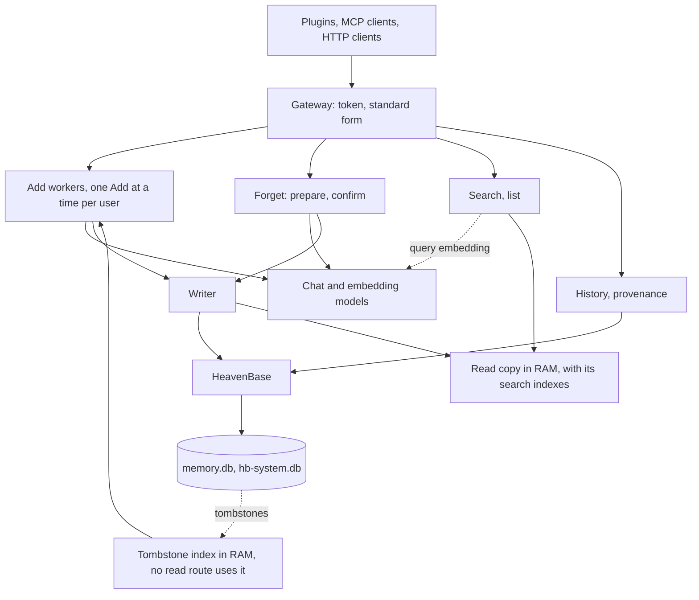
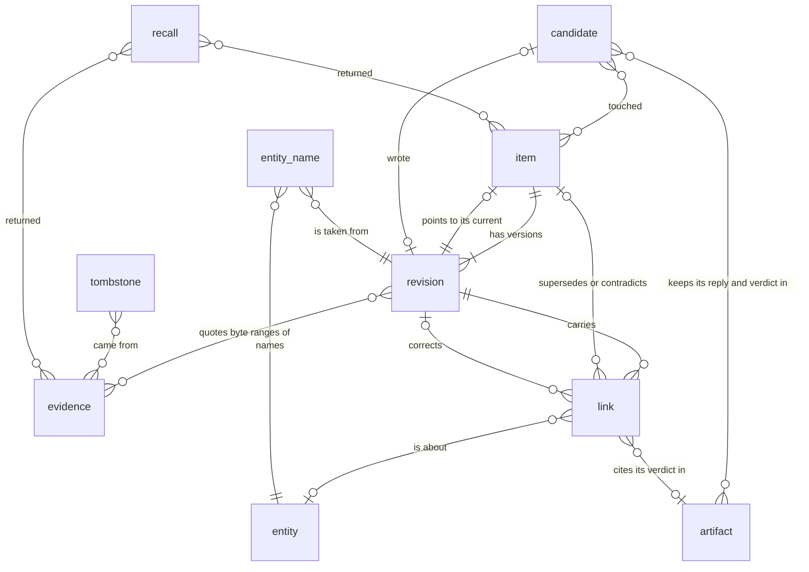
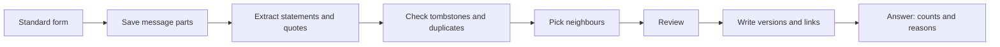

# How QuoteMem works

This page explains what QuoteMem does with a message, where it keeps each
record, and how reads, forgets and rebuilds use those records. The routes are
in [Run the memory service](service.md) and the settings in
[Configuration](configuration.md).

## Words used here

- **Add**: one call of `POST /memory/add`. It saves a chat's new messages and
  learns memories from them.
- **Message part**: a piece of a saved message, at most 1,000 bytes, with its
  byte offsets in the whole message.
- **Memory**: one short statement about the user or about someone or something
  in their life, with an id.
- **Version**: one state of a memory: its statement, quotes, time and vector.
  A memory's newest version is its current one.
- **Quote**: a byte range of a saved message that supports a version.
- **Link**: a relation between two memories, such as "this one replaces that
  one".
- **Review**: the step that compares a new statement with the memories near it
  and returns a verdict.
- **Tombstone**: the record of a forgotten fact that a forget leaves; every
  later Add is checked against it ([Checks before review](#checks-before-review)).
- **Dated after the forget**: said of a message that the service receives
  after the forget and whose own `timestamp` is later than the forget. The
  plugins send each prompt with the time it was said, and each turn they read
  from a host's transcript with the time the transcript gives. So in an
  ordinary chat, a message the user sends after the forget is dated after it.
  A message sent over HTTP needs a `timestamp` to count; the MCP add tool
  sends none.
- **Add mode**: how a store reads the messages of an Add. It is fixed when the
  store is created. `quotemem serve` creates a new store in the `agent` mode
  unless `--add-mode` names another, and the plugins start it that way. In
  this mode a `user` message is the user's own words, and the user's own
  statement of a forgotten fact in a message dated after the forget, when it
  shows no name a forget took, is not refused by its tombstone: review judges
  it as a new fact. The `lean-local` and `full` modes are for benchmarks.
  [The last section](#what-the-add-mode-and-the-review-change) compares them.

One store serves every `user_id`. Each row belongs to one user's part of the
store, and each route reads and writes only the part of the user it names.

## A message in nine steps

1. An Add saves the chat's messages in parts of at most 1,000 bytes, each
   with its byte offsets, time and a vector. Recognised credentials are
   redacted first, and tool output is not saved ([Saving](#saving)).
2. A model reads the new messages, writes short statements and copies the
   words each one rests on. The program, not the model, finds those words in
   the message and records their byte range ([Extraction](#extraction)).
3. A statement that states the same thing as a tombstone is refused, unless,
   in the `agent` mode, it is the user's own words in a message dated after
   the forget and shows no name a forget took; that one goes on to review.
   One that a stored memory already states with the same quote changes
   nothing ([Checks before review](#checks-before-review)).
4. Each other statement is compared with its neighbours: nearby memories,
   nearby tombstones, the messages it quotes, and earlier versions when it
   revises or corrects one. Fixed rules pick them, with no clock and no
   randomness ([Picking neighbours](#picking-neighbours)).
5. Review decides how the statement relates to each neighbour, for example
   the same, a supplement, an update, a correction or a contradiction, and
   whether it restates a forgotten fact. A verdict that would end a current
   memory, or deny a fact as forgotten, is confirmed by more votes
   ([Review](#review)).
6. An update writes a new memory with a link to the old one. Reads show the
   old memory as `past`, and one history shows the whole chain. Versions
   never change once written ([Writing](#writing)).
7. Every verdict is stored with the record of the neighbours it saw, and each
   version that a review admitted points to its verdict. So provenance can show why
   a memory was written or ended, and an interrupted Add goes on without
   repeating a model call ([Records and recovery](#records-and-recovery)).
8. A forget deletes or rewords each memory that states the fact, withholds
   the words that state it in the saved messages, and writes a tombstone
   ([Forgetting](#forgetting)).
9. Search and the list read the read copy in RAM, which holds no tombstone.
   Search's only model call is the embedding of the query. History and
   provenance read the stored rows ([Reading](#reading)).

## The parts

QuoteMem is one process with one data folder:

- The gateway serves the public routes. It checks the token and puts each Add
  body into one standard form.
- Adds of one user are handled one at a time, in the order they were
  received. A pool of workers runs the Adds of different users.
- One writer makes every durable change. Adds, forgets and deletions all
  commit through it.
- Search and the list use a read copy, held in the service's RAM, of each
  user's memories and message parts, with its search indexes. The writer
  replaces the copy after each commit. Search does not wait for an Add.
  History and provenance read the stored rows.
- HeavenBase, the included storage engine, keeps the tables in SQLite.



## The data folder

```text
<data dir>/                ~/.local/share/quotemem by default
  token                    the HTTP bearer token, unless one is set in the environment
  agent.json               the embedding model and dimension of the store's vectors
  spend.json               the day's spending, when a daily cap is set
  journal.key              the journal key, after the first export without a passphrase
  workspace/
    memory.db              QuoteMem's tables (SQLite)
    hb-system.db           HeavenBase's registry (SQLite)
    workspace.json         the store's identity and its fixed settings
    tenant.key             the key of the store's keyed digests
    memory.db.lock         held by the process that has the store open
    artifacts/             HeavenBase's module files
    catalog-ledger.bin     start-up records of HeavenBase's catalog
    catalog-proof.json     written at a clean stop, read and removed by the next start
```

The folder and `workspace/` are private to your user (mode 0700). The files
directly in them are mode 0600, and HeavenBase's module files are read-only.
While the service runs, SQLite also keeps `-wal` and `-shm` files beside both
databases.

`memory.db` holds every user's data. `hb-system.db` holds HeavenBase's
registry: its settings, its modules, and the record of the store, which names
`memory.db` as its database. It holds no user data. Each start of a store
checks that the record names the `memory.db` beside it, so the two files go
together. To back up a store, stop the service and copy the whole data
folder.

Some settings are fixed when the store is created. `workspace.json` holds the
Add mode, the review and the vector dimension. A start with other values is
refused with `workspace_binding_mismatch`. `agent.json` holds the embedding
model. A start with another embedding model is refused too, because the
vectors of two models cannot be compared. `quotemem rebuild` moves a store to
other settings ([Rebuild](#export-rebuild-and-deleting-a-user)).

`memory.db` holds twelve tables. In SQLite each table's name is
`agent_memory_` followed by the name below.

- `evidence`, one row per message part: the text, role, speaker, session and
  request ids, byte offsets, the message's own time, the time it was
  received, a vector, and the ranges a forget withheld.
- `item`, one row per memory: its state (for example current, replaced or
  corrected; reads show an ended memory as `past`) and its current version.
- `revision`, one row per version: the statement, its quotes (message part and
  byte range), kind (state or event), time, keywords, vector, and, when a
  review admitted it, a pointer to its verdict.
- `link`, one row per relation: `supersedes` (an update, correction or
  retraction, with the time an update took effect), `contradicts`,
  `corrects_history` (a memory that corrects one earlier version), and the
  entities a memory is about.
- `candidate`, one row per extracted fact of an Add: its outcome and reason
  code, the memories it touched, and its verdict.
- `entity`, one row per person or thing in a user's memories: its type and
  state, and no name.
- `entity_name`, one row per name of an entity: made from the memories that
  give the name.
- `tombstone`, one row per forgotten fact: the forgotten statement, its
  vector, kind, time, and the ids of its source messages.
- `control`, one row per setting or counter: the store binding, counters, the
  user id of each user's part, and per-user forget state.
- `artifact`, one row per record, keyed by its content hash: model replies,
  review calls and verdicts, neighbour records, forget receipts.
- `evolution_run`, one row per run: each Add, forget and start-up task, with
  its status.
- `recall`, one row per Search answer: which memories and message parts one
  Search returned.

The other tables in `memory.db` (such as `sys_catalog` and `sys_metaschema`)
and the table in `hb-system.db` belong to HeavenBase.

This is how the main tables point at each other. A label reads from the
table on the left to the table on the right. `artifact` is a store of
records keyed by their content hash: model replies, verdicts, neighbour
records and receipts. Other rows point into it by that hash, and many rows
can share one record.



The source is the saved messages and the forgets. The messages are in
`evidence`. A forget lives in the store as its tombstones and the forget
state in `control`. Add makes the memories, versions, links, names and review
records from the messages, and Search writes `recall`. The read copy, with
its search indexes, and the tombstone index are made from the tables each
time the service starts. The journal of `quotemem export` holds each Add's
messages, in order, and the forgets. `quotemem rebuild` replays them: the
Adds make every memory and record again, and each forget, replayed at its
place, writes its tombstones again.

**HeavenBase.** HeavenBase is included in the package. QuoteMem declares its
tables to it, and HeavenBase creates and opens the two SQLite files, runs the
queries and keeps its own registry, schemas and catalog. Both files use the
SQLite write-ahead log. Vectors are stored inside `memory.db`, packed as
64-bit floats. QuoteMem ranks search results itself, in the service process.
Every row QuoteMem writes goes through its own writer.

**Start-up.** The service checks its settings and the store binding first;
a missing or malformed setting stops it with exit code 1. It then binds its
port and checks every table against its declared schema. It
audits HeavenBase's catalog, unless the records of a clean stop show that
nothing changed since. It then finishes any Add, forget or deletion a stop
interrupted, and builds the tombstone index and the read copy. Until the
store is ready the memory routes answer 503.

## Adding: from a message to a memory



### The standard form

- A missing `user_id` is the service's user, and a missing `session_id` is
  `default`.
- A missing `request_id` is made from a hash of the user, the session and the
  messages, so a resent capture gets the same id.
- `tool` and `function` messages are dropped.
- Recognised credentials are replaced with `[redacted credential]`.
- Timestamps in seconds or ISO 8601 become milliseconds. A missing timestamp
  stays missing, and such a message is never dated after a forget.
- In the `agent` Add mode, a `user` message is the user's own words. Its
  `speaker` and `source_participant` are dropped.

### Saving

Each message is split into parts of at most 1,000 bytes, cut at character
boundaries. Offsets always count bytes in the whole message. Each part is
saved with its role, speaker, the message's time, the time it was received,
and a vector.

With `Prefer: respond-async`, the Add answers `202` once the parts are saved.
Sending the same request again returns the stored answer (`202` while the Add
is still running). A request that reuses a `request_id` with a different body
is refused with `operation_conflict`.

### Extraction

The new parts are grouped into units: a unit is a run of new parts that fits
one extraction request. Each unit gets one extraction call. The model is
shown the earlier messages of the same session, the new messages, the people
and things the user's memories already name, and related memories with their
latest earlier versions.

For each fact the model returns a short statement, its kind (state or event),
its time, who it is about, the memories it revises, and quotes copied from the
messages. The program then finds each quote in the message: exactly after
Unicode normalisation, else with runs of spaces collapsed, else with the first
letter in the other case. It records the byte range it found. A quote it
cannot find is dropped, and a fact with no quote left is not stored.

Each fact is then checked on its own:

- A fact about the user needs the user's own words.
- In the `agent` Add mode, a quote that is only a question does not support a
  fact, and neither does a quote of the assistant alone.
- A fact that breaks a rule costs only that fact. The rest of the Add goes on.

### Checks before review

A fact that states the same thing as a tombstone is refused: the same entity
and the same statement, ignoring case, width, spacing and closing
punctuation. It is refused with `denied_by_forget`, and its new quote is
withheld. In the `agent` mode there is one exception: when the fact rests on
the user's own words in a message dated after the forget and shows no name a
forget took, it goes on to review. A fact that shows such a name is settled
first by the name rule (**Names** under [Forgetting](#forgetting)). A fact
that is close to a tombstone, but not the same, also goes on to review, which
decides whether it restates the forgotten fact.

A fact that a current memory already states, citing the same words, changes
nothing (`restatement_satisfied`). Duplicates within one Add are folded into
one.

### Picking neighbours

Each remaining fact is compared with its neighbours:

- current memories about the same entities;
- memories with a close meaning;
- the memories the fact says it revises;
- earlier versions, when the fact names an earlier version it revises, or
  corrects one;
- other new facts of the same Add;
- tombstones with the same statement, or a close one;
- the messages the fact quotes, and the messages just before them.

Fixed rules pick this set. They read no clock and use no randomness, and ties
are broken by id, so the same inputs always give the same set. The record of
the set keeps ids, ranks and scores, never text.

### Review

The review sees the fact with its quotes, the neighbours, and the messages.
It returns:

- whether the quotes support the fact;
- for each neighbour memory: `independent`, `contradicts`, `same`,
  `supplement`, `update`, `correct`, `retract` or `unclear`;
- for each nearby tombstone, whether the fact restates the forgotten fact;
- a short reason.

Who reviews depends on the review mode:

- `fast`: local rules only, with no model call. A near-identical statement is
  the `same`, and a change the user states outright ("Hangzhou, not Beijing")
  is an `update`.
- `standard` (the default): local rules review the plain cases. The model
  reviews a fact that:
  - has a very close memory, or a very close new fact in the same Add;
  - announces a change;
  - may carry out a plan;
  - has a sensitive subject;
  - may restate a forgotten fact;
  - is told again by the user after a forget.
- `full`: the model reviews every fact.

A verdict that would end a current memory, or deny a fact as forgotten, is
confirmed. The fact is sent alone again, up to two more times, and the
verdict that two answers share decides. Without a majority, a denial stands
and no memory is ended.

### Writing

| Verdict | What is written | Reason code |
|---|---|---|
| `same` | the new quote, added to the memory | `merged_support`, `redundant` |
| `supplement` | a new version of the memory | `supplemented` |
| `update` | a new memory; a `supersedes` link ends the old one | `updated` |
| `correct`, `retract` | a new version, or a new linked memory | `corrected`, `retracted` |
| `contradicts` | a new memory with a `contradicts` link | `created_with_contradiction` |
| otherwise | a new memory | `created` |

`redundant` is the code when the new quote adds nothing. A correction or a
retraction writes a new memory, with a `supersedes` link, when the subject
changes.

An ended memory stays in the store, with its versions, and reads show it as
`past`. A message older than the memory it would end does not end it. A
statement that repeats a replaced version does not bring that version back.
Versions are never changed once written.

### The answer

`POST /memory/add` answers with six counts:

| Count | Example reason codes |
|---|---|
| `added` | `created`, `created_with_contradiction` |
| `corrected` | `updated`, `corrected`, `retracted` |
| `supplemented` | `supplemented`, `merged_support` |
| `unchanged` | `redundant`, `restatement_satisfied`, `duplicate_in_add` |
| `rejected` | `denied_by_forget`, `unsupported_by_source`, `secret_rejected` |
| `unresolved` | `relation_unclear`, `review_unavailable`, `older_than_target` |

The `agent` object of the answer adds:

- `status`: `stored`, or `partial` when a fact was rejected or left
  unresolved;
- `reasons`: the codes of those facts, with counts;
- `items`: each fact's category and code, in order;
- `added`: how many new memories a read still shows;
- `forgets`: what each forget request in the chat did.

`POST /memory/add-results` lists each fact with its code and the memories it
wrote. An unresolved fact stays pending. Some, such as `relation_unclear` and
`review_unavailable`, are reviewed again on the user's next Add.

### Records and recovery

Each review is stored in one transaction: the call, the verdict, and the
record of the neighbours. Each version that a review admitted points to its
verdict. Extraction replies are stored too. After a crash, the Add goes on from
these records and does not repeat a model call whose answer is stored.

## Reading

This section and the next two describe `quotemem serve`.

Search and the list read the read copy in RAM, which holds only committed
data and no tombstone. History and provenance read the stored rows. No read
route returns a tombstone.

**Search** (`POST /memory/search`):

- makes one model call: the embedding of the query;
- searches the memories and the message parts of the user;
- leaves out what a forget removed or withheld, the assistant's messages
  unless the query asks about them, and user messages that only ask or
  instruct;
- ranks by meaning and by shared words, and drops hits below a fixed
  relevance floor and hits far below the best one, so a question the store
  knows nothing about usually gets no hit;
- returns each hit as one `<memory untrusted="true">` block. A memory hit has
  the statement, the day it was said, a `Status:` line and up to two quotes.

The status is read from the whole store:

- `current`: the memory still holds;
- `past`: it was replaced, corrected or retracted;
- `possibly_outdated`: a newer memory contradicts it, or a newer user message
  may change it, and no review has settled it.

**List** (`POST /memory/list`) gives one page of a user's memories with the
same status and their quotes, newest change first.

**History** (`POST /memory/history`, body
`{"schema_version": 3, "user_id", "memory_id"}`) gives the versions of a
memory and of the memories it replaced, newest first. Each version has its
`change` (`create`, `update`, `correct`, `supplement`, ...), its `statement`,
its `supersedes` links with `effective_at` for an update, and its `quotes`
with `byte_start` and `byte_end` in the original message.

**Provenance** (`POST /memory/provenance`, body
`{"schema_version": 2, "user_id", "target": {"kind": "memory", "memory_id"}}`)
explains one version: its change, its outcome code, and the verdict that
admitted it (support, relations and reason). The reason is withheld when that
review was shown a tombstone, or something that has since been forgotten or
withheld. A version written without a review has no verdict.

**Add results** (`POST /memory/add-results`, body
`{"schema_version": 1, "user_id", "session_id", "request_id"}`) lists the
facts of one Add with their codes and memories.

History and provenance answer 404 `memory_not_found` for an unknown or
forgotten memory id.

## Forgetting

A forget has two steps.

**Prepare** (`POST /memory/forget/prepare`) finds what to forget. It changes
no memory and no message. For a forget by statement, it searches the user's
memories, takes the nearest ones by meaning too, and asks the model which of
them state the fact. It also finds the user's sentences that state it. Then
it reads each memory and sentence it would leave that names a forgotten value
as not, or no longer, the case. For each target not marked `bundled` (a
target that also states an unrelated fact, which goes whole), one that names
a name, number, code or e-mail address the target states as its own in a
contrast beside another (", not ...", "rather than ...") goes by rule. So
does one in which a clause whose subject is the user names such a value
after words saying it ended ("I no longer ...", "The user no longer ...",
"moved from", "used to") or before "anymore". In a clause whose subject is
someone or something else, such words take by rule a forgotten number, code
or e-mail address that follows them or comes before "anymore". The model is
asked about other contrasts.
One that the rule or the model takes goes too: a memory is
reworded without the words naming the old value (", not 14 Oak Street", "no
longer attends Qiming Kindergarten and"), or forgotten with it, and a quote
or sentence that names the old value is withheld, the part naming it or the
whole. It returns the memories that go, the other memories the forget
changes (`affected`: reworded, unreadable or forgotten), and the notice
`forget_keeps_unreadable_tombstone_v1`.

**Confirm** (`POST /memory/forget/confirm`) takes the prepare's
`confirmation` unchanged, within 10 minutes. It then:

- writes the tombstones;
- withholds the words that state the fact in the saved messages. The
  messages stay, and every read shows those bytes as `[withheld]`;
- deletes each memory that states the fact, with its versions, links, names
  and candidate records, and the search receipts that returned it;
- or rewords such a memory without the forgotten detail, when the rest still
  holds on its own: a forgotten name gives way to the tie, so "The user's cat
  is named Bob." can become "The user has a cat." The new wording is checked
  again before it is written, and the memory is deleted when a check fails.
  A reworded memory keeps its id, and no read shows the detail: history
  shows its earlier versions redacted;
- checks that the forgotten memories and sentences are no longer readable,
  and writes a receipt;
- for a forget by statement, checks what it left, and answers `incomplete`,
  with a last `left_readable` outcome that names no memory, when one of these
  checks finds something: a sentence the prepare listed is still wholly
  readable; a memory it removed or hid, or a past memory it left, leaves its
  own sentence wholly readable with a value it shares with a memory it took,
  or with an older memory it removed or hid that shares one: a name, place,
  number or code one of them states as its own value, or, for a past memory,
  the place both give as where someone lives; a memory
  the prepare listed as going is still read with such a value; a current
  memory, a readable part of its quotes, or a readable saved sentence other
  than a forget request still names a name, value or number of a target it
  forgot that is not marked `bundled`, or of an older memory it removed or
  hid that shares a value with what it took, as not, or no longer, the case,
  as the prepare's rule above reads it;
  or the value a rewording left out
  is still shown by a current memory, or by a readable part of a message the
  plan withholds from or the reworded memory quotes.

Each forgotten target's outcome in the confirm answer carries a receipt. Its
`counts` include `tombstones_written` and `evidence_spans_withheld`. Its
`readable_residual_count` is 0: a receipt is written only when that target's
own scan found nothing readable. Its `internal_retention` says what is kept:
`purpose` `block_relearning`, `readable` `false`, `content`
`statement_text_vector_anchors`. It is kept until the user is deleted or
every source message of the fact is erased; `quotemem delete-user` does both.

**The tombstone** holds the forgotten statement, its vector, its kind and
time, the entities it is about and the ids of its source messages. It names
no memory. Add reads it in the check before review, among the neighbours of a
review, and in a last check when the writer commits. When a new statement is
close to a tombstone, the review model is shown the forgotten statement, so
that it can tell a restatement. `quotemem export` writes the forgotten
statements sealed, and no read route returns them. As a second check, Search
uses what a forget recorded (the forgotten names, its topic words and the
forgotten statement's vector) to drop hits it reads as about the forgotten
fact. It does not count a name that two or more remaining memories still
state, a name in a hit the forget that took it read and kept, or, in the
`agent` mode, what the user's own later statement gives again. Search keeps
its list of those names and words only as keyed digests, in the `control`
table.

**Names.** In the `agent` Add mode, after a forget that took a name, an Add
reads each new fact for that name before review. A fact that shows it, about
the one who bore it, is
cut around it or refused. A cut fact quotes the message without the name,
and its statement names the bearer by its tie or says "someone": after
"forget my cat's name", "I took Bob to the vet" can become "The user took
the user's cat to the vet". The name's bytes that a cut or a refusal leaves
out are withheld in the new message before review, whatever review then
decides. Review judges what is left: it may keep it, refuse it or leave it
pending. The user's own later words that give the name are not cut, and
review judges them. When the checks of a forget by statement find a name it
took still readable, its confirm answers `incomplete` (above).
[Forgetting](forgetting.md) gives the rules.

**Told again.** While the tombstone is kept, in the `agent` Add mode, the
user's own statement of the fact in a message
[dated after the forget](#words-used-here) is not refused by that tombstone,
and Search does not drop it for the words it states again. Review judges it
as a new fact, and a statement that shows a name a forget took is still cut
or refused unless the user's own words give the name (**Names** above).
[Forgetting](forgetting.md) gives the exact rule. The old messages stay
withheld.

**Inside a chat.** A plugin turns "forget ..." into the two steps. A forget
request inside an Add's messages is also carried out with that Add, and the
`agent` object's `forgets` says what it did. When another forget of the same
user is running, it waits for its turn, up to 60 seconds. Once it has started
erasing, it runs to the end even if its Add has already answered and asked to
be retried; the retry then finds nothing left to do.

## Export, rebuild and deleting a user

**Export.** `quotemem export` writes a journal: one JSON object per line. It
holds each Add's messages, in the order the store took them in, and the
forgets. Withheld bytes are replaced with the `[withheld]` marker, and
forgotten statements are encrypted with AES-256-GCM under `journal.key` or a
passphrase. When a memory ended and its replacement was later forgotten, the
journal also gives the byte range of the ended memory's words, so a rebuild
ends it again. It holds nothing made from the messages: no memory, vector or
verdict. Export reads the store directly and makes no model call. It refuses
while the service has the store open, so stop the service first
(`quotemem stop`).

**Rebuild.** `quotemem rebuild --from <old data dir> --to <new data dir>`
writes only into a new, empty data folder. It first exports the old store's
journal, so stop the service that uses the old folder first. `--from` can
also name a journal file that `quotemem export` wrote, with the key that
sealed it (`--key-file` or `--passphrase-env`). The rebuild replays the Adds
in their original order with their original ids and times, and each forget at
its place in time. Every memory, vector, verdict and index is made again by
the current code, so rebuild calls the configured chat and embedding models.

A store is never changed in place. Rebuild is how a store takes other fixed
settings (the Add mode, the review, the vector dimension or the embedding
model), or is made again by a newer release. Then start the service on the
new folder: `quotemem serve --data-dir <new data dir>`, or put
`QUOTEMEM_DATA_DIR=<new data dir>` in `~/.quotemem/service.env`, the settings
file of the service the plugins start ([Configuration](configuration.md)).

**Deleting a user.** `quotemem delete-user` calls the running service. It:

1. stops taking the user's Adds, so an Add of that user that is still
   waiting is not stored;
2. forgets every memory of the user;
3. erases every saved message, review record, model reply and vector that
   cites them;
4. removes the tombstones whose sources are all erased;
5. ends with a checkpoint that empties the write-ahead log.

The store zeroes deleted space (SQLite `secure_delete`).

## What the Add mode and the review change

| Add mode | Review | `speaker` of a user message | Who reviews | Extra calls |
|---|---|---|---|---|
| `agent` | `fast` | dropped | local rules | none |
| `agent` | `standard` (default) | dropped | the model for some facts | none |
| `agent` | `full` | dropped | the model for every fact | none |
| `lean-local` | `fast`, fixed | kept | local rules | supplement, summary |
| `full` | `full`, fixed | kept | the model for every fact | supplement, summary |

- Extra calls are the calls of an Add besides extraction and review: the
  benchmark modes add a supplement call and a session summary.
- In the `agent` mode, a forgotten fact that the user states again in a
  message dated after the forget, and that shows no name a forget took, is
  not refused by its tombstone; review judges it as a new fact. The benchmark
  modes make no such exception.
- `quotemem serve` creates a new store in the `agent` mode unless
  `--add-mode` names another. The `lean-local` and `full` modes are the
  benchmark modes of `quotemem bench serve` (see [Benchmarks](benchmarks.md)).
